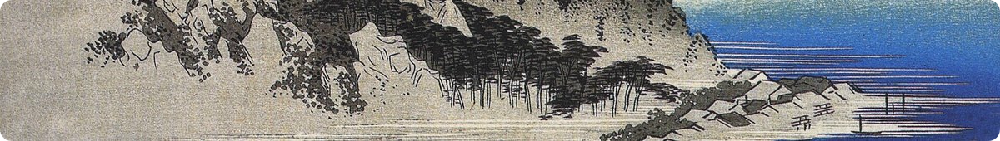

  <picture>
    <source media="(prefers-color-scheme: dark)" srcset="assets/banner-dark.svg" />
    
  </picture>

  
  
  

I work where firmware meets robots — MCU drivers, RTOS and DSP on one end, robot-arm control, VLA policy deployment and edge NPU inference on the other.

<b>中文简介</b>

 
中山大学电子与信息工程学院（SEIT）学生。关注嵌入式与机器人：一端是 MCU 驱动、RTOS 与信号处理，另一端是机械臂控制、VLA 策略部署与端侧 NPU 推理。

## Selected projects

<table>
<tr>
<td width="40%" valign="middle">

</td>
<td width="60%" valign="top">
<a href="https://github.com/skyswordx/STM32-accelerator"><b>STM32-accelerator · black-box circuit learner</b></a>
 2025 NUEDC, signal track, problem G
  
STM32H750 system that sweeps an unknown circuit with an AD9954, samples input and output on synchronized dual ADCs, identifies its frequency response via FFT and reconstructs time-domain waveforms in real time.
  

</td>
</tr>
</table>

<table>
<tr>
<td width="60%" valign="top">
<a href="https://github.com/skyswordx/ESP32-S3-ELECTRONIC-LOAD"><b>ELEVOURER · ESP32-S3 electronic load</b></a>
 SYSU SEIT engineering practice course
  
Portable smart electronic load with CC / CP / CR modes, real-time power monitoring and a touchscreen GUI.
  

</td>
<td width="40%" valign="middle">

</td>
</tr>
</table>

<table>
<tr>
<td width="40%" valign="middle">

</td>
<td width="60%" valign="top">
<a href="https://github.com/skyswordx/KyLink"><b>KyLink · edge messaging &amp; video on RK3566</b></a>
 Embedded Linux · on-device AI
  
LAN messaging (FeiQ protocol), GStreamer video streaming and RKNN NPU detection on RK3566 + Ubuntu Kylin, plus a board-level LED driver.
  

</td>
</tr>
</table>

<table>
<tr>
<td width="50%" valign="top">
<a href="https://github.com/skyswordx/armctrl"><b>armctrl</b></a>
 Robot arm · control &amp; SysID
  
Control and system-identification shell for the ARX5 arm: safety gates around planned motion, bounded agent action recipes and SysID orchestration.
  

</td>
<td width="50%" valign="top">
<a href="https://github.com/skyswordx/embegent"><b>embegent</b></a>
 Agent harness · MCU debugging
  
Agent-friendly harness for on-target STM32 debugging: structured state, evidence and context layers so a coding agent can run long debug sessions reliably.
  

</td>
</tr>
</table>

<b>More projects</b>

 
<table>
<tr>
<td width="30%"><a href="https://github.com/skyswordx/armodel"><b>armodel</b></a> Python · VLA · NPU</td>
<td>Model-side workspace for the arm stack: smoVLA post-training, export and NPU inference runtime</td>
</tr>
<tr>
<td><a href="https://github.com/skyswordx/Linky"><b>Linky</b></a> C · Linux</td>
<td>Lab for low-latency buffer ownership: buffer pools, memfd and DMA-BUF with descriptor rings, measuring tail latency</td>
</tr>
<tr>
<td><a href="https://github.com/skyswordx/final-tracker"><b>final-tracker</b></a> C++ · ROS1 · MuJoCo</td>
<td>Target-tracking UAV workspace: MuJoCo quadrotor bridge, UAM controller, perception, mapping and planning</td>
</tr>
<tr>
<td><a href="https://github.com/skyswordx/Gesture-DetectionRecognition"><b>Gesture-DetectionRecognition</b></a> Python</td>
<td>Camera-based gesture detection and recognition</td>
</tr>
<tr>
<td><a href="https://github.com/skyswordx/PID-Lambda-param-tuning"><b>PID-Lambda-param-tuning</b></a> MATLAB</td>
<td>PID tuning with the Lambda method</td>
</tr>
</table>

<b>Learning notes</b>

 
<a href="https://github.com/skyswordx/MYMCU">MYMCU</a> ·
<a href="https://github.com/skyswordx/MYFOC">MYFOC</a> ·
<a href="https://github.com/skyswordx/MYPCB-LAYOUT">MYPCB-LAYOUT</a> ·
<a href="https://github.com/skyswordx/PID-learning-record">PID-learning-record</a> ·
<a href="https://github.com/skyswordx/MY-DATA-STRUCTURE">MY-DATA-STRUCTURE</a> ·
<a href="https://github.com/skyswordx/rl-notes">rl-notes</a>

<!--
## Upstream contributions

| Project | Contribution | Status |
| --- | --- | --- |
|  [OWNER/REPO](https://github.com/OWNER/REPO) | [PR title](https://github.com/OWNER/REPO/pull/NUMBER) |  |
-->

## Toolbox

<table>
<tr>
<td width="22%"><b>Languages</b></td>
<td></td>
</tr>
<tr>
<td><b>Embedded</b></td>
<td> <code>STM32</code> <code>ESP-IDF</code> <code>FreeRTOS</code> <code>LVGL</code> <code>CMSIS-DSP</code> <code>FOC</code> <code>Modbus</code></td>
</tr>
<tr>
<td><b>Robotics &amp; AI</b></td>
<td> <code>MuJoCo</code> <code>LeRobot</code> <code>Pinocchio</code> <code>RKNN</code> <code>ONNX</code></td>
</tr>
<tr>
<td><b>Tools</b></td>
<td></td>
</tr>
</table>

## Activity

  

  

<picture>
  <source media="(prefers-color-scheme: dark)" srcset="https://raw.githubusercontent.com/skyswordx/skyswordx/output/github-snake-dark.svg" />
  
</picture>

  <picture>
    <source media="(prefers-color-scheme: dark)" srcset="assets/footer-dark.svg" />
    
  </picture>

